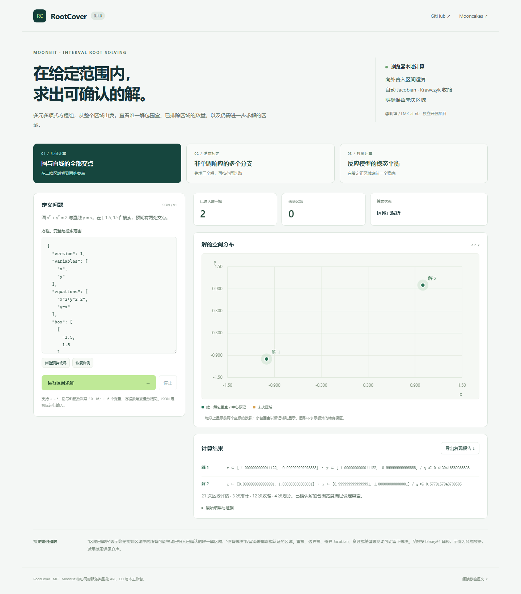

# RootCover

**在给定区域内，包围多元多项式方程组的实根，并明确保留无法判定的区域。**

RootCover 是独立的 MoonBit 区间求解库，面向几何计算、非单调标定和科学模型开发者。它从有限区域搜索，而不是要求调用者准备一批初值。结果区分已确认的唯一解、已排除区域与未决区域；预算耗尽不会把剩余区域标成“没有解”。

维护者与参赛者：**李明坤 / LMK-ai-nb**，个人参赛。项目使用 AI 辅助开发；维护者负责理解、复核与解释。独立来源与旧项目关系见 [ORIGIN](docs/ORIGIN.md)。

[GitHub](https://github.com/LMK-ai-nb/RootCover) · [浏览器工作台](https://lmk-ai-nb.github.io/RootCover/) · [Mooncakes](https://mooncakes.io/docs/LMK-ai-nb/rootcover) · [实际发布状态](docs/RELEASE.md)



## 五分钟运行

已验证工具链：moonc **0.10.17+093cb8f9c** / moon 0.1.20261021，Node.js 22+，Python 3.12+ 用于验证。运行求解器本身不需要 Python、npm install、API Key 或外部数值服务。

```text
moon run cmd/demo
node scripts/build.mjs
node bin/rootcover.mjs examples/geometry.json
node bin/rootcover.mjs examples/calibration.json
node bin/rootcover.mjs examples/equilibrium.json
node scripts/serve.mjs
```

打开 `http://127.0.0.1:4188`。网页与 CLI 调用同一份 MoonBit 内核。网页在 Worker 内运行，可停止求解、改输入、限制预算、选择标定分支并导出包含原始请求的报告。发布 ZIP 如已包含编译后的 dist/web 引擎，可以直接运行 Node 演示；更改 MoonBit 后重新 build。

CLI 退出码：0 为给定区域已解析；1 为保留未决区域；2 为无效输入或宿主错误。`node bin/rootcover.mjs -` 从 stdin 读取请求。

## 已实现的计算链路

1. 有界表达式解析与模型校验：1…6 个变量、等数量方程、+/-/*、括号、整数幂 0…16，总次数不超过 32。
2. IEEE-754 binary64 相邻值与向外舍入区间运算，正确处理零、次正规数、符号与溢出后的保守包围。
3. 区间前向自动微分，计算多元 Jacobian 的范围。
4. 自然区间排除与 Krawczyk 映像收缩；只有映像严格位于内部且无穷范数收缩界小于 1，才返回唯一解证据。
5. 确定性区域划分、根包围精化、深度/精度/预算限制，以及显式未决覆盖。
6. 类型化 API、严格版本化 JSON、CLI、离线浏览器、三类应用示例及重根反例。

这是一套可独立运行的求解器，不调用已有数值平台计算答案。算法思想已有成熟文献和实现，不主张算法发明、全球唯一或比成熟系统更快。[同类调查与独立价值](docs/RESEARCH.md) 明确披露已有区间算术、数值求根和外语区间求解器。

## 三个完整使用场景

| 使用者与问题 | 输入和操作 | 实际预期结果 | 验证 |
| --- | --- | --- | --- |
| 几何工具开发者，需要一个区域内的所有圆线交点 | `geometry.json`：x²+y²−2=0、y−x=0，范围 [-1.5,1.5]² | 两个唯一解区域，分别包含 (-1,-1)、(1,1)，未决为0 | 核心测试、CLI、浏览器 |
| 标定软件开发者，需要避免非单调曲线只返回一个逆解 | `calibration.json`：x³−3x+1=0，先查 [-2.5,2.5]，再查 [0,1] | 先包围3个分支；限定范围后仅剩约0.3472963553的一个分支 | CLI、浏览器分支操作 |
| 科学模型开发者，需要在指定正区域找反应模型稳态 | `equilibrium.json`：1−4x+x²y=0、3x−x²y=0，x∈[0.1,2]、y∈[0.1,6] | 一个唯一解区域，包含 (1,3)，未决为0 | CLI、浏览器 |

所有输入均为合成模型，不代表真实客户、实验室或工业系统。完整输入、输出含义和步骤见 [SCENARIOS](docs/SCENARIOS.md)。`singular.json` 的 x²=0 保留包含0的未决区域，不能把重根当作已确认的唯一解。

## 在自己的 MoonBit 项目中复用

```text
moon add LMK-ai-nb/rootcover@0.1.0
```

调用包中导入 `LMK-ai-nb/rootcover`。公开 API 的可执行例子在 [API.mbt.md](API.mbt.md)，单独消费包见 `cmd/demo`。

| API | 返回内容 |
| --- | --- |
| `interval` / `Interval` methods | 向外舍入的闭区间计算 |
| `parse_polynomial` / `validate_system` | 明确语法和模型边界 |
| `enclose` | 方程和 Jacobian 区间 |
| `assess` | 单盒排除、唯一解证据、收缩或未决 |
| `solve` | 初始区域中的根包围、未决覆盖、完成/精度标记及统计 |
| `decode_request` / `solve_json` | 严格 JSON 输入与传输无关的结果 |

`complete=true` 只讨论输入初始区域，且不等于无限精度；`tolerance_met` 单独报告已确认根包围是否达到用户要求。`complete=false` 时 `root_count` 仅为已确认的根数，不能当作全部根数。完整解释见 [SEMANTICS](docs/SEMANTICS.md)。

## 验证

```text
python scripts/verify.py --browser
# 具备本机C工具链时：
python scripts/verify.py --native --browser
```

脚本记录每个真实命令、退出码和输出到 `artifacts/validation.json`。当前有23项 MoonBit 测试（含可执行 API 文档）、7项 Node 集成；独立 Python Fraction/AST oracle 覆盖2800组区间算术、180个解析可知的方程组，重新计算447份唯一解证据。Chromium 验证三场景、分支选择、预算、报告、错误输入及390px布局。有限测试不是对任意方程和后端的形式化证明。

本机未配置 MSVC/Windows SDK，不能将本地的全目标静态检查写成 native 实际运行。远程 CI 的真实状态见 [发布记录](docs/RELEASE.md)，配置文件本身不是成功证据。

## 数值范围与后续工作

本版专注**单一有限区域内的方形多项式方程组**。不支持超越函数、复根、符号精确因式分解、非方系统、全局优化、区间不确定系数、自动读取真实实验数据或安全认证。小残差不构成唯一性保证。边界根、重根、病态模型或资源限制可能保留未决。

字面量系数与边界按 binary64 数值解释，不承诺精确十进制语义。包围论证依赖 IEEE-754 正确舍入和渐进下溢，不应使用破坏这些语义的 fast-math。最多512个表达式节点、深度32；最多20000次区域评估、搜索深度80。复杂度仍可能很高，浏览器使用 Worker 隔离与取消。

下一阶段优先做经许可的真实模型集成、严重缩放/病态问题的系统评测、可选更高精度后端及更有效的分割策略；这些未实现能力不列入当前申报承诺。

MIT；[依赖与来源](THIRD_PARTY_NOTICES.md)。报名仅准备事实清单和本人填写提纲，未代提交或确认承诺；[规则核对](docs/RULES_2026-11-04.md)。
