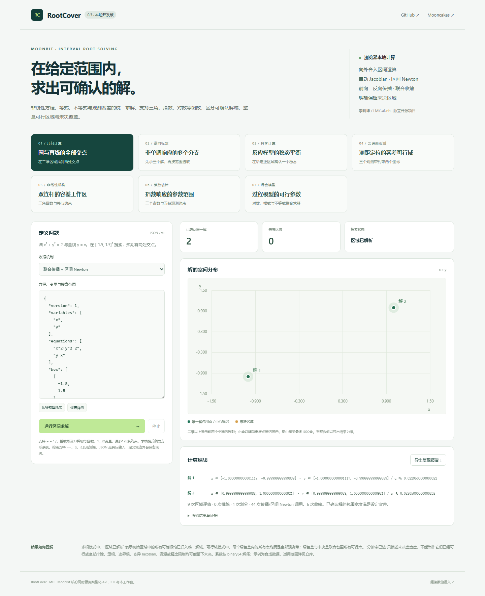

# RootCover

**MoonBit 非线性约束区间求解库：区域求根、等式、不等式与带误差观测的可行域。**

当前工作副本是 **0.4.0-dev.1，本地开发版，尚未推送或发布**。GitHub、Pages和Mooncakes仍为0.2.0，不能用`moon add`取得本轮新增能力。维护者：李明坤 / LMK-ai-nb。[来源与历史关系](docs/ORIGIN.md)。

面向机构计算、参数估计和科学模型开发者，求解给定区域中的多个解或可行参数范围。核心、解析、区间导数、收缩与搜索均用MoonBit独立实现，不依赖Julia、外部数值引擎或网络服务运行。既有数值方法与成熟实现已披露，不主张算法首创或全面超越已有求解器。



## 本地运行

工程目录 `D:\CodexProjects\RootCover`；MoonBit0.10.17、Node22+。

```text
moon run cmd/demo
node scripts/build.mjs
node bin/rootcover.mjs examples/robot_roots.json
node bin/rootcover.mjs examples/robot_workspace.json
node bin/rootcover.mjs examples/thermal_parameters.json
node bin/rootcover.mjs examples/mixed_process.json
node bin/rootcover.mjs examples/robust_localization.json
node bin/rootcover.mjs examples/design_alternatives.json
node bin/rootcover.mjs examples/scaled_parameters.json
node scripts/serve.mjs
```

浏览器打开 http://127.0.0.1:4188 。网页、CLI和typed API共享内核；Worker计算支持停止、编辑请求、导出及传播/Newton/联合机制切换。CLI退出码0表示全部分类，1表示仍有未决，2表示错误；上列六个可行域示例退出1是预期结果。

## 本轮已实现

0.4新增正公式all/any/at_least、异常观测共识、逐变量绝对/相对精度、BFS与归一化/Jacobian影响划分。完整[同类检索与取舍](docs/LANDSCAPE_2026-11-13.md)、[语义和例子](docs/SET_ALGEBRA.md)。


| 能力 | 接口和范围 |
| --- | --- |
| 表达式 | `+ - * /`、括号、整数幂0…16及负整数幂；13种函数：sin/cos/tan/exp/log(ln)/sqrt/abs/atan/asin/acos/sinh/cosh/tanh |
| 区间计算 | 向外舍入四则、带余项界的初等函数、区间自动Jacobian；显式定义域和光滑性状态 |
| 区域求根 | Krawczyk唯一性证书、独立区间Newton收缩、传播与有界搜索；未决覆盖保留 |
| 非线性约束 | 非方等式、≤、≥、观测带；前向—反向传播、变量依赖agenda、预条件区间Gauss-Seidel与坐标Newton联合收缩、SIVIA内外包围 |
| 输入上限 | 1…32变量、1…128约束，总AST节点8192、深度64；初始盒有限，预算有限 |

新调用使用`parse_expression`；`parse_polynomial`保持旧严格语法。`Constraint.polynomial`字段名为0.2兼容保留，其值可以是完整非线性Expr。`interval_newton`、`contract_constraints`可单独调用，返回收缩盒/空、调用次数和固定点预算状态，不单独声称可行或唯一。可执行例子见[API.mbt.md](API.mbt.md)。

## 初等函数与联合收缩场景

| 用户/用途 | 可运行输入 | 实际结果 |
| --- | --- | --- |
| 机构计算开发者求双连杆逆解及位置误差允许的关节角范围 | robot_roots.json、robot_workspace.json；三角关系和关节约束 | 精确问题两组唯一逆解；容差问题2个内盒、21个未决盒，分辨率0.02 |
| 参数估计开发者反演指数响应 `a*exp(-k*t)+b` | thermal_parameters.json；3变量、5观测/非负约束 | 537个内盒、2974个未决盒；保留(2,0.5,0.25)，分辨率1/64 |
| 科学模型开发者联立对数、根式和非线性不等式 | mixed_process.json；跨定义域初始范围 | 5个内盒、45个未决盒；保留(1,0.7)，分辨率1/64 |

均为合成模型，不声称真实设备采用、统计置信度或机械安全认证。完整用户、输入、操作、输出与验证见[SCENARIOS](docs/SCENARIOS.md)。旧几何/标定/稳态/测距/六元64根示例保留。

## 组合与精度场景

| 用户/用途 | 可运行输入 | 实际结果 |
| --- | --- | --- |
| 测量开发者在四条观测至少三条成立时定位，并保留必选边界 | robust_localization.json；嵌套all/at_least | 15内盒、38未决；保留(1,1)；严格全部满足的对照可证明空 |
| 设计开发者在指数/根式两个设计中保留任一可行方案 | design_alternatives.json；all/any与公共资源约束 | 184内盒、204未决；保留两分支，间隙不当作内盒 |
| 参数开发者分别控制百万量级偏置与千分之一增益的精度 | scaled_parameters.json；BFS、逐变量绝对/相对精度 | 226内盒、277未决；分辨率达到不代表未决可行 |

完整输入、操作与独立验证见[SET_ALGEBRA](docs/SET_ALGEBRA.md)。

## JSON调用

`mode:"roots"`或省略mode求方形系统；`mode:"feasibility"`求一般约束。约束可用`{"expression":"log(x)+y","range":[0.68,0.72]}`，或`{"expression":"x^2+y^2","relation":"<=","rhs":2}`。range与relation/rhs二选一；range的下/上端点null表示下/上无界，结果区间同理，null不代表数值0。初始box仍须有限。可用formula组合全部/任一/至少k条，search选择dfs/bfs、widest/scaled/smear及逐变量精度；见SET_ALGEBRA。

可加 `"contractors":{"propagation":true,"newton":true,"max_steps":256,"max_rounds":4}`。max_steps由全查询共享；耗尽后回到区间判定/细分，不丢待处理区域。`options`中的tolerance、max_assessments、max_depth继续有效。重复键、未知字段、任意函数调用、严格不等式及越界资源拒绝。

## 正确理解结果

唯一性仍须严格Krawczyk证据，Newton/传播负责排除和收缩。每个可行内盒中所有点满足约束；内盒∪未决包围全部可行点。未决不是可行点，盒数不是解数。显式formula时内盒证明整个正公式成立，不要求每条原子都成立；逐原子证据会导出。complete、resolution_met和收缩固定点状态分别解释。

log/sqrt/反三角定义域、除数含0、tan极点与abs非光滑区不会直接获得错误的整盒/唯一性判定。初等函数使用区间级数和余项界，不假设宿主libm误差≤1ulp；大三角参数和过宽周期逆像保守放宽。详见[NONLINEAR](docs/NONLINEAR.md)、[根语义](docs/SEMANTICS.md)、[可行域语义](docs/PAVING.md)。

## 验证与基准

```text
python -m pip install -r requirements-dev.txt
python scripts/verify.py
# 安装Playwright/Chromium后：
python scripts/verify.py --browser
```

mpmath1.3.0仅用于100位独立验证。浏览器测试另需`pip install playwright`、`python -m playwright install chromium`；可把PLAYWRIGHT_BROWSERS_PATH设在本工程work。具备本机C工具链可加`--native`。脚本记录实际命令/退出码，报告见[VALIDATION](docs/VALIDATION.md)；本轮没有触发远程CI。

实际运行Julia1.13.3 / IntervalRootFinding.jl0.7.2：20模型、Newton和Krawczyk共40次；16常规模型唯一根数量吻合，3奇异/边界模型均未决，极点处理有一处已披露差异。不是全API兼容或速度排名。[基准与复现](docs/BASELINE.md)。

当前wasm/wasm-gc/js各58项测试、25项CLI及完整21步均通过。旧Fraction核对继续覆盖2800组算术、182系统、513份根证据；高精度函数/导数、134模型在三种机制下共402次收缩保留继续通过。正公式另有54模型、284份精确内盒证据、162次配置收缩及24组搜索策略验证。有限测试不是形式化证明。

## 边界与来源

实数、binary64点常数和有限初始区域。不支持任意精度、复根、整数、全局优化、任意回调/显式Jacobian、否定/量词、搜索恢复或严格不等式。重根、边界、奇异/非光滑、宽区间、高维和资源限制均可能未决；32变量是输入上限，不是大规模完成保证。

MIT，标准库许可和NOTICE随分发保留。[调研](docs/RESEARCH.md)、[第三方来源](THIRD_PARTY_NOTICES.md)。0.3/0.4均是本仓库0.2基础上的扩展；来源、已有项目重合和未实现边界如实披露，本地开发不代表官方审核通过。
