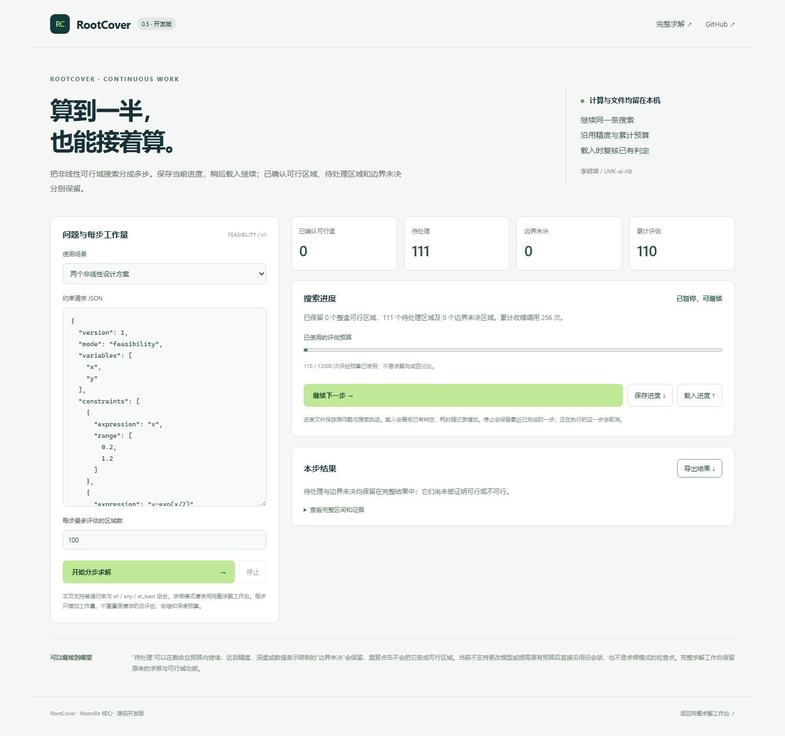

# 分步可行域搜索与可复核进度文件

0.5 源码，2026-11-13。仅普通/正公式可行域模式；求根模式仍使用原单次接口。同一RootCover的扩展，实际源码/网页/包状态见RELEASE.md。

## 运行

`PavingSession` 把同一次搜索拆成多步。在内存中直接推进当前队列。载入文件时先核验轨迹，再处理剩余区域。以下命令在源码根目录运行。

```text
node scripts/build.mjs
node bin/rootcover.mjs examples/robust_localization.json --steps 10 --checkpoint robust.rootcover-checkpoint.json
node bin/rootcover.mjs --resume robust.rootcover-checkpoint.json --steps 20000 --checkpoint robust.rootcover-checkpoint.json
```

首步实际评估10盒、保留9个待处理盒；继续到累计127次评估时得到15个内盒、38个边界未决，待处理为0。与相同请求的单次求解结果相同。两次退出码均为1：末次仍有边界未决，不代表失败。

CLI会原子替换已有进度文件；拒绝把原模型文件或不相关文档覆盖为检查点。示例将进度保存在当前项目目录；其他位置请先建立父目录。进度文件含用户自己的完整模型；默认`*.rootcover-checkpoint.json`被Git忽略。

运行 `node scripts/serve.mjs` 后打开本地分步工作台。载入会核验轨迹，累计评估数保持原记录。载入失败或取消时，会保留当前模型和最近一次成功完成的进度。可以继续搜索、保存进度或导出结果。[本地工作台](http://127.0.0.1:4188/session.html) · [在线工作台](https://lmk-ai-nb.github.io/RootCover/session.html)



## 六变量设计约束复现

合成模型把六个归一化设计参数限制在 `[0,1]`，要求五条约束中至少四条同时成立。模型包含乘积、平方和指数约束，分辨率要求为 `0.3`。[输入 JSON](../examples/design_window6.json)

1. 在分步工作台选择「六变量设计约束（五选四）」，设置每步 `700` 次评估并开始求解。首次暂停时累计评估 `700` 次。
2. 保存进度、刷新页面并载入保存的 JSON。核验完成后累计评估仍是 `700` 次。此时也可试载入任意缺失检查点字段的 JSON，查看当前模型与进度是否保留。
3. 把每步评估数改为 `20000`，继续并导出结果。预期总评估 `5191` 次、整盒可行 `750` 个、边界未决 `1798` 个、待处理 `0` 个。报告中 `resolution_met=true` 表示未决盒宽度达到给定分辨率，这些盒保留供后续分析。[分步工作台](https://lmk-ai-nb.github.io/RootCover/session.html)

从源码目录运行以下命令也能复现。前三次求解退出码均为 `1`，表示仍有未决。最后一条命令自动比对跨进程恢复与单次求解的 JSON，比较时仅移除会话附加信息。

```text
node scripts/build.mjs
node bin/rootcover.mjs examples/design_window6.json --steps 700 --checkpoint design-window.rootcover-checkpoint.json
node bin/rootcover.mjs --resume design-window.rootcover-checkpoint.json --steps 20000 --checkpoint design-window.rootcover-checkpoint.json
node bin/rootcover.mjs examples/design_window6.json
node --test --test-name-pattern="six-variable design" tests/session.test.mjs
```

## 类型化接口

- `new_paving_session(source)`解析并独占一个可行域请求，内部状态不向外开放。
- `advance(steps)`增加1…20000次评估内的工作；累计总额仍受原请求max_assessments限制。
- `snapshot()`输出结果JSON，包括可行盒、未决、累计统计与session状态。
- `checkpoint()`保存原请求与覆盖轨迹；`restore_paving_session`核验并恢复。
- `envelope()`一起输出结果和检查点。公开可编译例子在API.mbt.md。

JS桥接的start/advance使用同一内存会话；load只核验载入，restore载入后推进。CLI每次运行是新进程，使用文件恢复。

## 覆盖如何核验

格式v1包含`kind:"rootcover.feasibility"`、原请求字符串和顺序事件。文件中的“已排除”“内盒”或任意缓存队列不被直接信任。

1. 从初始盒重建DFS/BFS队列，每个事件消费下一个盒，深度从分割推导。
2. 按累计剩余额度重新计算传播/Newton收缩；可靠的空收缩才可排除。
3. split必须严格位于推导盒的一个坐标内部，两子盒联合覆盖父盒。恢复不重算这些内部节点的划分启发式或区间分类。
4. inside/outside叶子的区间判定重新计算；精度/深度/表示终止同样核对。
5. 缺少事件只会留下待处理盒。越界分割、伪造叶子、超预算、完成后的额外事件、重复键和未知字段被拒绝。

内盒∪未决因此仍包围检查点所载原问题的全部可行点。若有人更改内嵌原问题，核验针对显示出来的那个问题，不证明文件身份或外部原稿未变。另一条有效细分轨迹也可能通过；这不是数字签名或任意文件修改都必拒绝的承诺。

文件恢复复杂度随记录增长，重新执行收缩和终端证据检查；不声称零开销、任意模型更快或与IBEX COV格式互通。内存advance保留队列，不重放已完成轨迹。

## 状态与边界

- 步数是本轮新增工作，assessments是累计工作。原总评估上限≤20000、深度≤80、收缩max_steps和逐变量精度都延续。
- `pending_boxes`仍可处理；`terminal_unknown_boxes`已到精度/深度/表示限制。二者都在unresolved中，均不当作可行点。
- `can_advance=false`可能是队列已处理，也可能是总评估预算用完；不等于complete。只有没有任何未决时complete才为true。
- `resolution_met`不证明未决可行；预算条显示使用额度，不是完成百分比。
- 请求限256Ki UTF-16单位、检查点4Mi；事件不得超过原总评估预算。
- 当前不支持更改模型/提高预算后沿用会话、从单次结果恢复、根证书恢复或跨引擎版本位级一致保证。跨环境复核失败会报错，不跳过证据。

## 三个工作流

| 使用者与问题 | 输入及操作 | 输出及验证 |
| --- | --- | --- |
| 测量开发者保留观测共识搜索进度 | robust_localization先10步写入文件，另一个CLI进程载入继续 | 最终15内盒/38未决，与单次相同；跨进程与同文件原子替换测试通过 |
| 设计开发者关闭页面后继续比较方案 | design_alternatives先10步保存，刷新载入，再100步 | 载入后仍为 10，拒绝无效记录后可继续；Chromium 另核对取消和结果导出 |
| 参数反演库调用者按交互预算推进 | thermal_parameters内存分块，间隔保存恢复 | 六个非线性场景分别在DFS/BFS下与单次输出逐字段相同，共12组对照 |

## 验证与来源

会话验证覆盖 MoonBit 实现、公开 API 文档和 9 项 JS/CLI 测试。独立Fraction参考48模型、548份结果状态、9074次内盒证据复核、44791次可行样本覆盖检查。240个轨迹修改中190拒绝，其余50份继续通过独立覆盖/证据检查。状态与内盒会跨暂停重复核对，不当作不同数学问题。

有限回归不是形式化证明、任意篡改检测或工业可靠性保证。完整命令见VALIDATION.md。

可继续搜索、pending/unknown及覆盖状态参考[IBEX策略/COV](https://ibex-team.github.io/ibex-lib/strategy.html)与[IntervalRootFinding搜索对象](https://juliaintervals.github.io/IntervalRootFinding.jl/latest/internals/)。没有复制上游实现；覆盖轨迹与核验路径独立编写，不主张上述数值思想首创。

暂停时尚未处理的盒在结果 JSON 中同样标为 `status=pending`，与预算耗尽同类。
